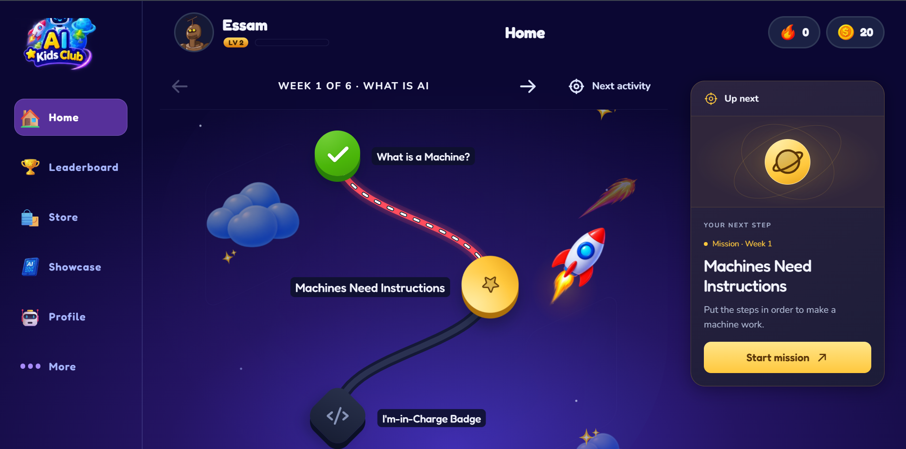
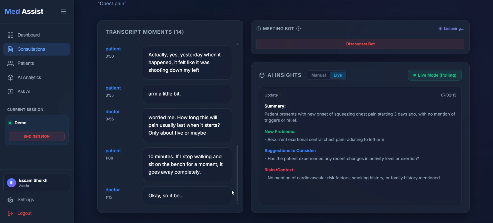
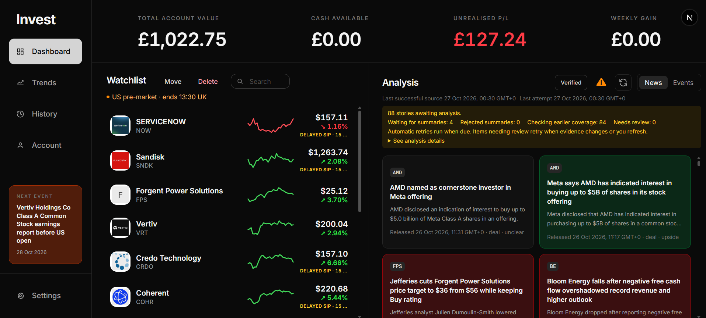
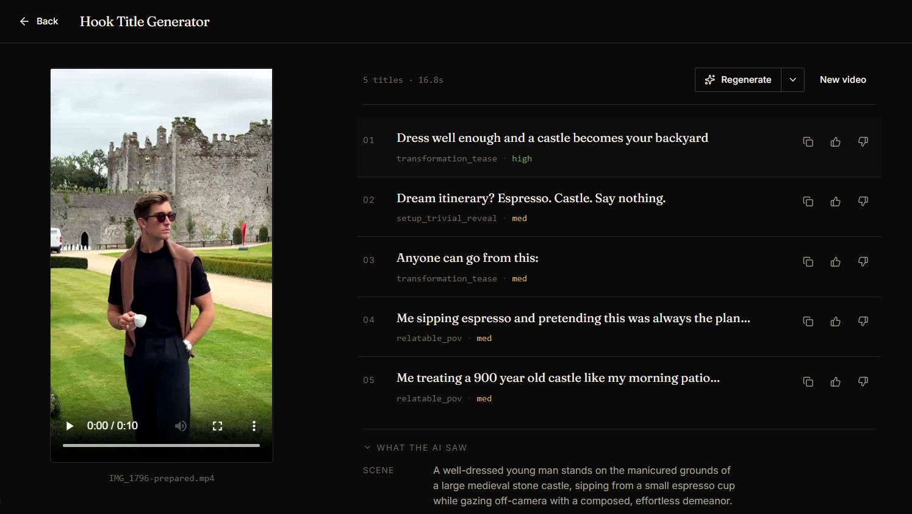

# Hi there, I'm Essam Sheikh!

I am a Computer Science and Artificial Intelligence graduate with First-Class Honours from the University of Birmingham. I’m passionate about building robust full-stack applications, intelligent AI solutions, and developer tools that solve real-world problems. 

### 🚀 What I'm Doing Now
* **Software Engineer at London Gulf Nexus:** Building the MVP for a gamified web platform that teaches AI fundamentals to young learners through interactive missions.
* **Building & Shipping:** Constantly working on personal software engineering projects, ranging from clinical AI systems to algorithmic stock trading tools.

---

### 🛠️ Tech Stack & Tools
* **Languages:** Python, Java, TypeScript, JavaScript, SQL
* **Frameworks & Libraries:** Spring Boot, Next.js, React, FastAPI, LangChain, LangGraph, Hugging Face, RAG, JHipster
* **Databases & Vector Stores:** PostgreSQL, Supabase, FAISS
* **DevOps & Tools:** Git / GitHub, Docker, VS Code, IntelliJ, PyCharm, Claude Code, Vercel

---

### 💡 Featured Projects

<table border="0" cellpadding="0" cellspacing="0">
  <tr>
    <td align="center" valign="middle" style="border: none;"><strong><a href="https://aikidsclub.info/">AI Kids Club</a></strong> <em>Under Development</em></td>
    <td align="center" valign="middle" style="border: none;"></td>
  </tr>
</table>
* *Tech Stack:* Next.js, TypeScript, Supabase (PostgreSQL), Tailwind CSS, Vercel
* *Overview:* A gamified web learning platform designed to teach children and young learners aged 7–18 the fundamentals of artificial intelligence through interactive, mission-based challenges, engaging 2D avatar systems, and dynamic progress maps.

<table border="0" cellpadding="0" cellspacing="0">
  <tr>
    <td align="center" valign="middle" style="border: none;"></td>
    <td align="center" valign="middle" style="border: none;">
      <h4><a href="https://github.com/essam2414/Med-Assist">Med-Assist (AI Clinical Online Consultation App)</a></h4>
      
<em>Tech Stack:</em> Python, FastAPI, RAG, FAISS, LangChain, Docker, Playwright, Faster-Whisper

      
<em>Overview:</em> A privacy-focused clinical assistant that joins Google Meet calls locally to transcribe audio, generate automated post-call and live in-call summaries using medical guidelines via RAG, and provide live clinical insights via a Chrome extension and a LangGraph "Ask AI" chatbot.

    </td>
  </tr>
</table>

<table border="0" cellpadding="0" cellspacing="0">
  <tr>
    <td align="center" valign="middle" style="border: none;">
      <h4><a href="https://github.com/essam2414/Trader">Trader</a></h4>
      
<em>Tech Stack:</em> Python, APIs, Data Analytics

      
<em>Overview:</em> A custom stock market trading and analysis application that integrates market data feeds to track real-time momentum, process news sentiment, calculate automated support and resistance levels, and generate dynamic AI buy scores for a customized equity watchlist.

    </td>
    <td align="center" valign="middle" style="border: none;"></td>
  </tr>
</table>

<table border="0" cellpadding="0" cellspacing="0">
  <tr>
    <td align="center" valign="middle" style="border: none;"></td>
    <td align="center" valign="middle" style="border: none;">
      <h4><a href="https://github.com/essam2414/Title-Generator">Title-Generator</a></h4>
      
<em>Tech Stack:</em> Python / Software Utilities

      
<em>Overview:</em> A prototype app for creating burn-in title ideas for social media short-form videos. Upload a B-roll clip, such as footage from an Instagram creator, and the app analyses its visuals, finds similar reel examples, and suggests on-screen title text that fits the footage.

    </td>
  </tr>
</table>

---

### 👨‍💻 Experience
* **Software Engineer** | *London Gulf Nexus* (April 2026 – Present)
  * Developing end-to-end features using Next.js, TypeScript, Supabase, and Vercel for an interactive EdTech platform.
* **Student Ambassador** | *University of Birmingham* (June 2025 – January 2026)
  * Guided university visitors, facilitated student activities, and managed event logistics for large-scale graduations and open days.
* **AI Intern** | *Zircon Tech* (August 2024 – September 2024)
  * Leveraged open-source AI models (ViT, ResNet) from Hugging Face to research and assist in building a brain tumor (GBM) image classifier from MRI medical data.

---

### 📫 Connect with Me
* **LinkedIn:** [essam-sheikh](https://www.linkedin.com/in/essam-sheikh/)
* **Email:** [essamsheikh24@gmail.com](mailto:essamsheikh24@gmail.com)
